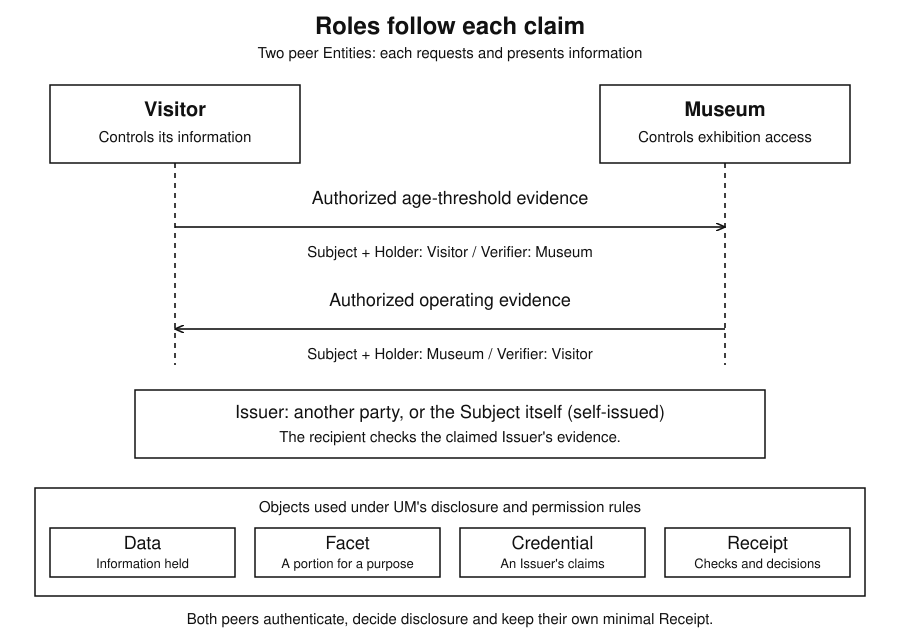
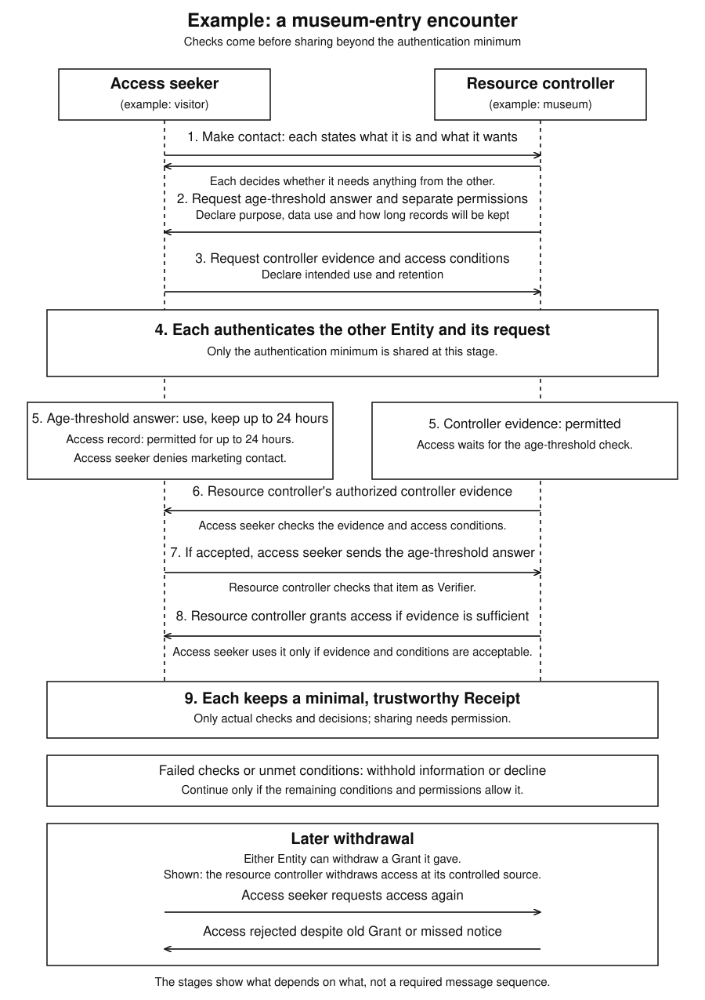
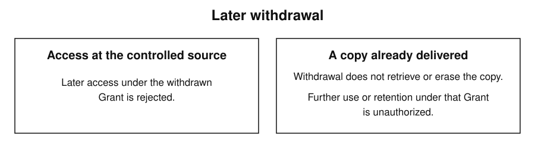

# Universal Manifest: Permissions and Handshaking
# OMA3 Technical Working Group (TWG)

## Introduction

A visitor arrives at an age-restricted exhibition in a virtual museum. Museum needs evidence that Visitor meets the age condition. Visitor needs evidence that Museum operates this entrance before providing the age answer. Both sides have something to ask for, something to check and something they can refuse.

The exchange should answer those questions without exposing unrelated information. Museum needs to know whether Visitor is old enough, not Visitor's birth date. Permission for admission does not authorize marketing. Visitor's other information should remain private, including any indication that undisclosed information exists.

Each side asks for what it needs and declares how it will use it. Each checks the other participant and its request, then gives separate permission decisions. Museum presents its operating evidence first; Visitor then presents the age answer. Each decides whether to proceed and keeps its own limited record. Later, either can withdraw a Grant it gave.

## Purpose

Permissions and Handshaking sets out what Universal Manifest (UM) needs to provide for two participants to request information or access, check evidence, grant or refuse permission, keep a limited record and later withdraw permission. The OMA3 Technical Working Group can use the requirements to judge proposed solutions.

The museum encounter makes these needs concrete. They also apply when a person, organization, application or agent meets a store, checkpoint, service or another agent. Other Universal Manifest use cases build on this exchange.

## Scope

This use case follows one encounter between two participants. It covers their requests, authentication, permission decisions, information released or withheld, evidence checks and records. It also covers later withdrawal and its effect on access to information or resources that remain under the granting participant's control.

The requirements describe outcomes. They leave the transport, storage arrangement, Credential format, message sequence and use of a central service to solution proposals. They also leave open whether a Facet carries or points to a Credential. The numbered actions show what depends on what, not a required number of network messages.

Withdrawal changes permission from that point onward and changes later access at a source still under the grantor's control. It cannot recall information already delivered.

## Use Cases

### System

The System is Universal Manifest. It supports the requests, checks, permission decisions and records described here. The participants, the network between them and any external Issuer of evidence are outside the System.

Each participant controls its own information and resources. A shared server is not required.

### Participants

An **Entity** is a person, organization, application or agent with its own Universal Manifest. An agent acts for an Entity that is responsible for it.

The two participants in this encounter are:

- **Visitor**, the Entity asking to enter the exhibition.
- **Museum**, the Entity controlling the entrance.

A participant asking for something is a **requester**. A participant receiving something is a **recipient**. Visitor and Museum both request and receive evidence in this encounter.

### Evidence roles

A **claim** is a statement about something, such as "Visitor is eighteen or over" or "Museum operates this entrance." Four roles describe how an Entity relates to a particular claim:

| Role | Meaning |
| --- | --- |
| **Subject** | The Entity the claim is about. |
| **Holder** | The Entity holding and presenting the claim. Holder is often Subject, but an agent can hold and present a claim about a person. |
| **Verifier** | The Entity checking the evidence for a claim it receives. |
| **Issuer** | The Entity making the claims in a Credential and supplying their evidence. Issuer can be another party or the Subject itself. |

These roles belong to each claim, not permanently to one participant. For the age claim, Visitor is Subject and Holder, and Museum is Verifier. For the operating claim, Museum is Subject and Holder, and Visitor is Verifier.

### Associated objects

- **Data** is the information an Entity holds in its Universal Manifest. Holding it does not authorize anyone else to receive it.
- **Facet** is a portion of Data prepared for sharing for a particular purpose.
- **Credential** is a set of claims from an Issuer, with evidence a recipient can check. It shows who is claimed to have issued it.
- **Receipt** is an Entity's record of the checks it made and the decisions it took during an encounter.

### Permission and evidence

#### Permission

**Permission** authorizes a named recipient to perform a specified action on information or a resource, for a stated purpose and under stated conditions, such as a retention period. A **Grant** gives that permission, a **Denial** refuses it and **Withdrawal** ends a Grant for future actions. Each participant can decide separately for each action and purpose, so one encounter can contain several Grants and Denials.

A Grant is valid only if the Entity giving it has authority to do so. That may be the Entity the information or resource belongs to, or an agent acting within its authority. Permission to disclose information and authority to act for another Entity are separate. Neither implies the other.

#### Five separate questions about evidence

**Authentication** establishes which Entity sent a request, presented evidence or supplied other information. It does not establish that a claim is true, that the sender is trustworthy or that it may act for someone else. A recipient needs to keep five questions separate:

- **Who sent this?** Authentication identifies the Entity that sent the request or presented the evidence.
- **Who does the Credential say issued it?** This is its claimed origin. A Credential is **self-issued**, often called self-signed, when its Issuer is the Subject of its own claims. It is **externally issued** when its Issuer is another party. A self-issued Credential is clearly marked as self-issued; the absence of that mark does not establish external issuance.
- **Has the recipient checked that Issuer's evidence?** A claim of external issuance remains unchecked until the recipient checks that Issuer's evidence.
- **What does the evidence establish about the claim?** The recipient judges the claim from the evidence it actually checked. A **self-assertion** is a claim an Entity makes about itself. An authenticated self-issued Credential, by itself, shows that its Subject made the claim; it supplies no independent support. Whether that is enough depends on the claim and purpose, and the recipient decides.
- **May the Holder act for another Subject?** When Holder acts for someone else, it must establish the authority needed for the requested action. Authenticating the sender or possessing a Credential does not establish that authority.

Self-issuance concerns who supports the claim, not the strength of its cryptography. Authenticating the Entity presenting a Credential does not establish who issued that Credential. A Holder can present another party's Credential without becoming its Issuer or making it self-issued. Origin information concerns only the Credential presented and reveals nothing about Credentials that were withheld.

Figure 1. Evidence travels in both directions. Subject, Holder, Verifier and Issuer are roles for each claim. Both participants request information, decide what to permit and keep their own records.

### Permissions and Handshaking Use Case

#### Starting conditions

Visitor holds evidence that can answer an age-threshold question: whether someone is at or above a stated age. Museum holds evidence that it operates this entrance. Each participant has a way to check the other's authentication evidence and has rules governing what it will disclose and to whom. Neither has yet received permission to obtain the other's sensitive information.

For this example, Museum admits visitors aged eighteen or over. It needs only the answer to that age question and asks to keep a minimal admission record for no more than twenty-four hours. It also wants permission for marketing contact, a separate purpose.

Visitor's Data includes a legal name, contact details, a payment method and health records. None is needed for admission. The age threshold and retention period are example conditions, not rules for every UM encounter.

#### Trigger

Visitor chooses to enter the exhibition.

Figure 2. Both participants check requests before sharing information beyond the authentication minimum. The stages show dependencies, not prescribed messages. Later withdrawal changes access at the controlled source.

#### Actions

1. **Establish what each participant wants.** Visitor and Museum make contact and describe themselves. Visitor asks to enter; Museum states that it controls the entrance. Each decides whether it needs anything from the other before continuing. These initial statements still need checking.

2. **Museum makes specific requests and declares its terms.** Museum asks for the answer to "Is Visitor eighteen or over?" so it can decide on admission and asks for permission to keep that answer for no more than twenty-four hours. It declares its data-use policy and asks separately for permission to keep a minimal admission record for no more than twenty-four hours. It asks separately for permission to make marketing contact.

3. **Visitor makes its own request and declares its terms.** Visitor asks for evidence that Museum operates this entrance and for the access conditions. Visitor declares that it will use the operating evidence only to decide whether to enter and keep it for no more than twenty-four hours. In both directions, requests identify the needed information, intended action, resource, purpose, data-use policy and retention period. A broad request must be narrowed to specific information before disclosure.

4. **Check the participants and their requests.** Each participant authenticates the other and the request it received, then checks that request against its own rules. A substituted sender, an altered request or replay of evidence bound to a different encounter fails these checks. Authentication discloses only the minimum evidence needed for that check; that minimum can itself be sensitive. The requests have been exchanged, but the requested responses remain withheld beyond the authentication minimum.

5. **Give separate permission decisions.** Each participant decides separately for each requested action and purpose:

   - Visitor grants Museum permission to receive the age answer, use it for admission and keep it for no more than twenty-four hours.
   - Visitor grants Museum permission to keep the minimal admission record for no more than twenty-four hours.
   - Visitor denies marketing contact.
   - Museum grants Visitor permission to receive its operating evidence, use it to decide whether to enter and keep it for the declared period.

   Neither side has to accept a request in full. Either can reduce or refuse a requested combination of items that could identify it, even if each item appears harmless alone. Either can refuse to send a response that exceeds its own disclosure limit.

6. **Visitor checks Museum's evidence.** Museum presents the authorized operating evidence and states its access conditions. For this claim, Museum is Subject and Holder, and Visitor is Verifier. The Credential claims an external Issuer. Visitor checks that Issuer's evidence before relying on the claim. Museum's own assertion that it operates the entrance would be self-issued and would not provide independent support.

7. **Museum checks Visitor's age answer.** If Visitor accepts Museum's operating evidence and access conditions, Visitor presents the authorized age-threshold answer without a birth date. For this claim, Visitor is Subject and Holder, and Museum is Verifier. The answer rests on a Credential claiming an external Issuer. Museum checks that Issuer's evidence supporting the answer. Any evidence disclosed to support the answer stays within the requested and authorized disclosure. The response contains no unrequested information and no list or hint of Visitor's other Data or Credentials.

8. **Each decides whether to proceed.** Museum grants exhibition access when the evidence meets its admission condition. Visitor enters only if Museum's operating evidence and access conditions are acceptable. Each makes its own decision.

9. **Keep each participant's own record.** Visitor and Museum each keep a minimal Receipt supporting only the checks they made and decisions they took, within the agreed retention limits. Either may share its Receipt with the other participant or anyone else only under valid permission from an Entity authorized to grant that disclosure. Keeping a record does not itself authorize sharing it.

#### Alternatives and exceptions

- **The encounter may end at first contact.** If the other party cannot meet a basic condition for the entrance, the encounter ends before any request. A virtual football drifting toward the entrance is not admitted simply because it calls itself a visitor.
- **A failed check stops further disclosure.** If authentication or the request check fails, the affected participant withholds information beyond the authentication minimum and the encounter ends.
- **A refusal can leave a narrower action available.** If requested information is denied, unavailable or insufficient, the participants may continue only with an action whose remaining conditions are met within the permitted scope. Otherwise the encounter ends without admission. Denying marketing contact does not stop admission when the admission conditions are met.
- **A self-issued Credential may offer less support than expected.** The recipient decides whether it is enough for the claim and purpose. Authentication establishes who made the self-assertion; it adds no independent support.
- **A claimed external Issuer may be unchecked.** If the recipient cannot check that Issuer's evidence, the claim of external issuance remains unchecked. The recipient can ask Holder to clarify the claimed Issuer and supporting evidence before relying on the Credential. It decides whether to proceed on that basis or decline, and must not report a check it did not make.
- **Holder may be acting for someone else.** Presenting a claim about another Subject does not by itself mean acting for that Subject. When Holder does act for another Subject, such as an agent entering for a person, it must establish the authority needed for the requested action. Possession of a Credential does not establish that authority.
- **Another checker is another recipient.** If Museum or Visitor wants a third party to check an item, forwarding it requires a valid Grant covering that recipient, action, resource, purpose and conditions. The Grant must come from an Entity authorized to give it, such as the Entity the information belongs to or an agent acting within its authority. Permission to disclose to the original recipient does not extend to the checker.
- **Uncertain permission prevents the controlled action.** If current permission cannot be established, the Entity controlling the resource refuses the action. An earlier Receipt does not supply current permission.

#### Outcome

**On success,** Visitor enters the exhibition. Museum holds the authorized age answer for admission under the twenty-four-hour retention limit, with separate permission to keep the minimal admission record for the same period. Visitor holds Museum's operating evidence for the declared purpose and period. Each keeps its own permitted, minimal Receipt within the agreed retention limits.

Museum has received no Visitor information beyond the permitted age answer, its authorized supporting evidence and the authentication minimum. The choices have different effects:

- **A Grant limits what the recipient may do.** The age answer reaches Museum with permission for admission under the stated conditions.
- **A Denial refuses an action.** Museum has no permission for marketing contact. That Denial does not change what Museum received.
- **Unrequested information stays with its holder.** Visitor's name, contact details and payment method were not sent.
- **Protected information remains unreadable and undisclosed to unauthorized recipients.** Visitor's health records can be read only by a recipient of an authorized kind. Museum is not one and cannot tell whether they exist. They are never listed or hinted at, whether or not requested or denied.

These conditions can overlap. They do not define a fixed set of states for every item of Data.

**On failure,** Visitor is not admitted. What each participant holds depends on when the encounter ended. Failure during authentication or the request check leaves no disclosure beyond the authentication minimum. Either participant may still have made a minimal Receipt of its own checks and decisions.

A later failure can leave an authorized item with its recipient. For example, Museum may receive the age answer but find its Issuer unacceptable. The recipient may keep and use the disclosed item only within its Grant's purpose, conditions and retention period. Ending the encounter does not withdraw the Grant. Each participant records only its own actual checks and decisions.

#### Later withdrawal

Either participant can withdraw a Grant it gave, including after the encounter ends. Withdrawal ends that permission from then on, even if the recipient misses the notice.

Withdrawal also changes later access at the **controlled source**: the place still under the granting Entity's control where the information or resource is reached. For Museum, that is the exhibition entrance. For Visitor, it can be a Facet in Visitor's Universal Manifest. The source rejects later access under the withdrawn Grant. Withdrawal cannot pull back copies already delivered.

- **Visitor withdraws permission to retain the admission record.** Museum may no longer rely on that Grant. Continued retention or any new use under the withdrawn permission is a violation. UM cannot erase the copy Museum already holds.
- **Museum withdraws exhibition access.** The entrance rejects Visitor's next request for entry under that Grant, even if Visitor missed the notice or still holds the earlier Grant. A past Receipt cannot restore access. This use case leaves open what happens to a Visitor already inside.
- **An Entity withdraws permission for later access to a Facet.** The source rejects the recipient's next attempt to read it under that Grant, even if the withdrawal notice did not arrive.

Figure 3. Withdrawal rejects later access at the controlled source. It cannot retrieve or erase a copy already delivered; further use or retention under the withdrawn Grant is unauthorized.

## Threat Model

The threats below follow Visitor's side of the museum encounter. Each can also occur in the other direction.

### Impersonation and alteration

An attacker uses Museum's name, substitutes itself for the sender or changes a request in transit, such as replacing the stated purpose. Visitor then shares information with the wrong party or under terms it never accepted.

### Replay

An attacker captures evidence tied to one encounter and uses it as authority for a different encounter, another recipient or an action whose permission has been used up. This differs from Holder presenting a still-valid Credential again with permission in a new encounter.

### Requests and responses that reveal too much

Museum asks for more than admission needs because asking is easy and refusing feels awkward. A broad request encourages Visitor to volunteer information Museum never named. Several requested items that seem harmless alone could identify Visitor together. Museum may also demand a birth date when an age-threshold answer would suffice, and Visitor's software may send the more revealing response without asking.

### Linking separate encounters

Two recipients compare disclosures and recognize the same Visitor. A recipient and an Issuer compare notes and learn where Visitor went. A value that stays the same across encounters lets records be matched. It can appear in a signature, proof, Receipt, freshness check or status pointer.

A **freshness check** uses a value supplied by one side to show that the other's evidence was made for this encounter. A stable value in that check can track Visitor across encounters. A **status pointer** is a place to query whether evidence or permission remains current. Its use can reveal who is asking about whom, and a stable value in it can also allow tracking.

A reference to an item can give different recipients the same address, allowing them to link encounters. The party serving that reference can see which recipients fetch it. Even a list or hint of items that were never disclosed can fingerprint Visitor: recipients can recognize it from that pattern without reading the items.

Linking can also result from mistaken identity. If Visitor's software treats two different recipients as one because they give the same self-asserted name, it may combine information intended for separate recipients.

### Permission misuse

Museum uses admission information for marketing, keeps it beyond the agreed period or continues acting on a withdrawn Grant. A missed withdrawal notice makes a stored Grant appear current. A recipient treats a Denial as silence and later as consent. Once a recipient holds a copy, later controls at the source cannot reach it.

### False assurance

A participant reports a check it never made or describes unreadable protected information as checked. It assumes Holder is Subject, treats a self-assertion as independent support or forwards an unchecked claim as verified. It may also infer authority to act from identity or possession of a Credential alone.

It may accept a claimed external Issuer without checking that Issuer's evidence, infer external issuance from the absence of a self-issued mark or mistake the authenticated sender for the Issuer of a Credential inside the presentation. It may also mistake a Receipt of an earlier decision for current permission.

## Requirements

SHALL and SHALL NOT state required outcomes. SHOULD states a recommendation; a departure needs a reason. MAY states an allowed option. These words follow RFC 2119. The requirements describe what a solution needs to provide; they do not claim that an existing solution provides it. The museum's age threshold and retention period are examples.

### 1. Permission decisions and withdrawal

**1.1. Separate decisions.** UM SHALL allow an independent permission decision for each requested action on a resource for a stated purpose.

**1.2. A Grant's scope and authority.**

- UM SHALL bind each Grant to its authorized recipient, action, resource, purpose and conditions.
- UM SHALL treat a Grant as valid only when given by an Entity authorized to give it, such as the Entity the information or resource belongs to or an agent acting within its authority.

**1.3. No assumed permission.**

- UM SHALL NOT treat denied, missing, expired or withdrawn permission as a Grant.
- UM SHALL deny a controlled action when current permission cannot be established.

**1.4. Continuing within a narrower scope.** UM SHALL allow an encounter with denied, missing or insufficient information to continue only for an action whose remaining conditions are met within the permitted scope.

**1.5. Purpose and retention limits.**

- UM SHALL treat use outside a granted purpose as a violation.
- UM SHALL treat retention beyond the agreed period as a violation.

**1.6. Withdrawal and later access.**

- UM SHALL allow the granting Entity to withdraw a Grant after the encounter.
- UM SHALL treat later reliance on a withdrawn Grant as unauthorized.
- UM SHALL require the controlled source to reject later access under a withdrawn Grant, even when the withdrawal notice did not reach the requester.

Withdrawal cannot recall delivered copies. Ending an encounter does not itself withdraw a Grant.

### 2. Requests and disclosure

**2.1. Specific requests and declared terms.**

- Before sensitive disclosure, UM SHALL require each requester to declare the needed information, intended action, resource, purpose, data-use policy and retention period.
- UM SHALL require a broad request to be narrowed to specific information before disclosure.

**2.2. Limits on shared information.**

- UM SHALL limit evidence disclosed for authentication to the minimum that check needs.
- UM SHALL transmit requested information only when its disclosure is authorized.
- UM SHALL NOT transmit unrequested information beyond the authentication minimum.

**2.3. Control over revealing responses.**

- UM SHALL allow either Entity to reduce or refuse a requested combination of items that could identify it.
- UM SHALL allow either Entity to refuse to send a response more revealing than its own disclosure limit.

**2.4. An age answer without a birth date.** UM SHALL support an age-threshold answer without disclosing the birth date.

**2.5. Protected and undisclosed information.**

- UM SHALL prevent an unauthorized recipient from reading protected information.
- UM SHALL NOT reveal whether undisclosed Facets exist, through a list, hint or any other indication.

**2.6. Permission for each further recipient.** UM SHALL NOT treat permission to disclose information to one recipient as permission to disclose it to another recipient.

Forwarding an item for checking needs a valid Grant covering that further recipient, action, resource, purpose and conditions, from an Entity authorized to give it.

### 3. Authentication, verification and acting authority

**3.1. Authenticate before accepting or disclosing.**

- UM SHALL authenticate the other Entity before any disclosure beyond the authentication minimum.
- UM SHALL authenticate the sender of a request before accepting that request.

**3.2. Distinguish Entities with the same name.** UM SHALL distinguish authenticated Entities even when they use the same self-asserted name.

**3.3. Detect changes and reject replay.**

- UM SHALL detect changes to information from a sender before accepting it.
- UM SHALL reject replay of evidence tied to one encounter as authority for a different encounter, a different recipient or an action whose permission has been used up.

Presenting a still-valid Credential again with permission is a separate use, not by itself such a replay.

**3.4. Establish authority to act for another Subject.**

- UM SHALL require a Holder acting for another Subject to establish the authority needed for the requested action.
- UM SHALL NOT infer authority to act from sender authentication alone.

**3.5. Report only what was checked.**

- UM SHALL limit what it reports as verified to what the evidence actually checked supports.
- UM SHALL NOT report a self-assertion, including one carried in a self-issued Credential, as having independent support.

**3.6. Keep Credential origin separate from sender authentication.**

- UM SHALL make the claimed origin of a presented Credential distinguishable, so that a self-issued Credential is clearly marked as self-issued.
- UM SHALL treat a Credential's claim of an external Issuer as unchecked until the recipient has checked that Issuer's evidence.
- UM SHALL NOT treat a Credential as externally issued merely because it carries no self-issued mark.
- UM SHALL NOT treat authentication of the Entity presenting a Credential as evidence of who issued that Credential.

**3.7. Ask about a Credential's claimed Issuer.** UM SHOULD allow a recipient to ask Holder to clarify a presented Credential's claimed Issuer and supporting evidence before relying on it, especially when external issuance is claimed.

### 4. Privacy across encounters and each party's record

**4.1. No tracking value introduced by UM.**

- UM SHALL NOT introduce an identifier or fingerprint that lets different recipients link an Entity's separate encounters.
- UM SHALL prevent a freshness check from carrying a value that can track an Entity across encounters.

**4.2. Protect privacy when using references.**

- UM SHOULD prevent an item delivered as a reference from linking an Entity's encounters with different recipients.
- UM SHOULD prevent the party serving a reference from learning which recipients the Entity encountered.

**4.3. Keep status pointers optional.** UM SHALL keep any status pointer optional, so that no encounter requires a check that reveals who is asking about whom.

**4.4. Keep minimal, verifiable Receipts.**

- UM SHALL limit each Receipt to the information needed to support its author's own checks and decisions.
- UM SHALL make a Receipt's author verifiable within its encounter.
- UM SHALL make alteration of a Receipt detectable.
- UM SHALL prevent Receipt content from linking separate encounters.

**4.5. Receipt use and disclosure.**

- UM SHALL NOT treat a Receipt as current permission.
- UM SHALL require permission before a Receipt is disclosed to another party. That permission must come from an Entity authorized to grant the disclosure.
